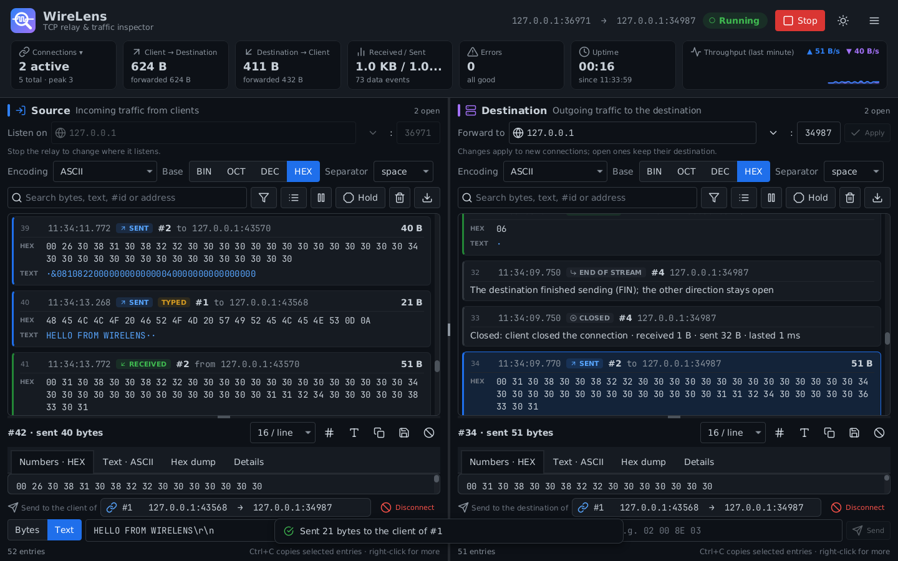
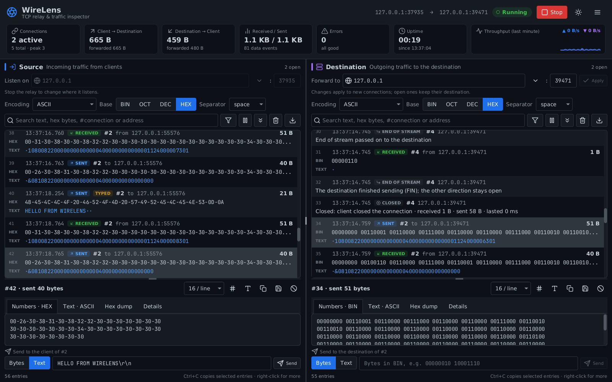
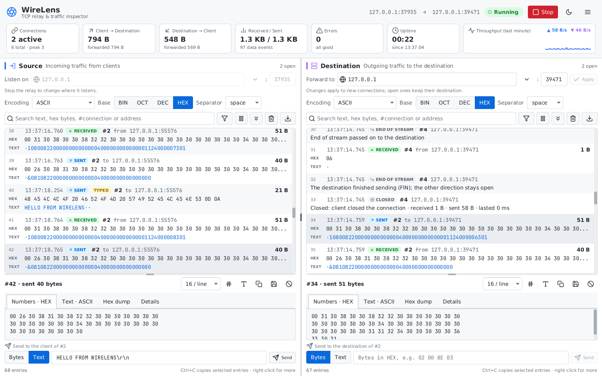
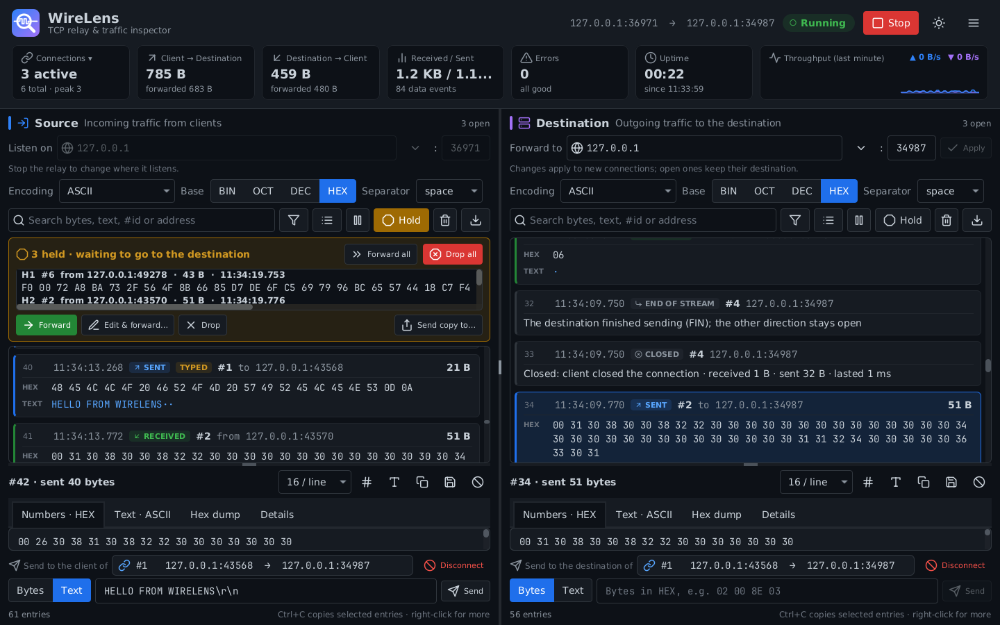
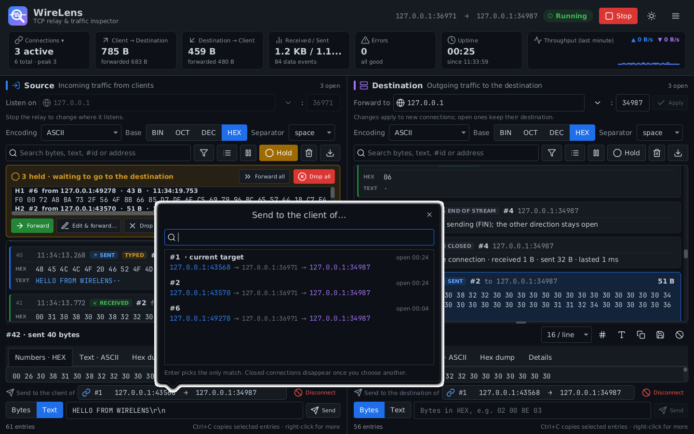
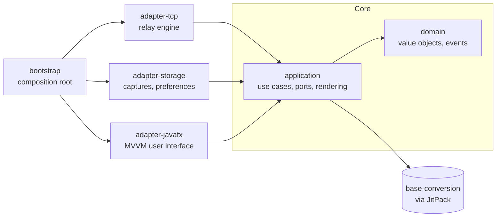

<div align="center">


# WireLens

**A TCP relay and traffic inspector with a modern JavaFX interface.**

*A lens on the wire: the bytes between your client and server, made visible.*

Put WireLens between a client and a server, and see every connection, every byte and every event,
in text and in binary, octal, decimal or hex. Nothing is lost along the way.




</div>

---

## Why WireLens?

Debugging a TCP protocol usually means switching between three tools: a port forwarder, a packet sniffer
and a hex viewer. WireLens does all three for one route:

```
 client ──▶ WireLens (listen IP:port) ──▶ destination IP:port
        ◀──                          ◀──
```

It was built with payment systems in mind. Examples: a POS terminal talking ISO 8583 to a host, an HSM
link, or a mainframe gateway that still speaks EBCDIC. It works with any TCP protocol, though, from
line-based text to raw binary frames.

## Features

| | |
|---|---|
| **Real relay** | Forwards every client to the destination in both directions and passes half-closes on correctly. IPv4 and IPv6 are supported. One simple blocking pump per direction, on platform threads (virtual threads are opt-in). |
| **Two synchronised panels** | **Source** shows the client side and **Destination** shows the server side. One connection id (`#3`) ties both legs together. |
| **Every event as its own entry** | Connected, received, sent, end of stream, closed (with reason, totals and duration), errors (listen, connect, read, write, send) and info messages. Each entry has a timestamp, addresses, ports, direction and byte count. |
| **Raw bytes are the source of truth** | Bytes are stored once and never changed. Text, numbers and hex dumps are all derived from them when displayed. |
| **Independent view selectors per panel** | Encoding (ASCII, UTF-8, ISO-8859-1, EBCDIC IBM037, UTF-16BE), base (BIN / OCT / DEC / HEX) and separator (space, none, `-`, `:`, `,`, or your own). A change re-renders all entries instantly. |
| **Inspector** | Shows the selected entry in full: numbers (with bytes per line), decoded text, a classic hex dump, and all metadata. Every view is read-only, selectable and copyable. |
| **Copy anything** | Copy the numbers, the decoded text, the canonical raw hex (`008E`) or whole entries (`Ctrl+C`), or save the exact bytes to a `.bin` file. |
| **Hold mode (intercept)** | Turn on **Hold** in a panel and every message from that side stops at the proxy. Then **Forward** it, **Edit & forward** (bytes or text), **Drop** it, or **Send a copy** to another address and see the reply. **Forward all** and **Drop all** are there too. Order per connection is kept, and other connections keep flowing. |
| **Connection-first sending** | Pick the target connection from a searchable list (`client → proxy → destination`), then **Send** or **Disconnect**. There's no need to find an event first. A closed target stays visible, greyed out, until you choose another. |
| **Send box** | Type bytes (`02 00 8E 03`) or text with escapes (`PING\r\n`, `\x02`) and send them to the client or to the destination. Sent bytes are marked **TYPED**, and edited held bytes are marked **EDITED**. |
| **Find things fast** | Search text, hex byte sequences (aligned to byte boundaries), `#connection` or addresses. Filter by event kind. Show a single connection. |
| **Capture control** | Pause and resume per panel (traffic keeps flowing, and the panel counts what it skipped). Sort by **Live** (follows new entries), newest, oldest, largest, smallest, by connection, received first or sent first. Clear panels and reset statistics. |
| **Export and reopen** | Export to *WireLens JSON Lines* (lossless, so you can open it again later) or to a text report with hex dumps for tickets. |
| **Live header** | Status, route, active / total / peak connections (click for the searchable list of open connections), bytes in each direction, received / sent totals, errors, uptime, and a one-minute throughput chart. |
| **Strict address input** | IPv4 and IPv6 are checked on every keystroke with clear messages (`300 is out of range`, `'::' may appear only once`). Invalid endpoints cannot be submitted. |
| **Made for heavy traffic** | Events are batched onto the UI thread at most 15 times a second. History is limited both by entry count and by bytes, and an overload is reported instead of crashing the app. |
| **Light and dark themes** | Uses AtlantaFX Primer, remembers your settings, and has keyboard shortcuts. |

<details>
<summary>More screenshots</summary>

**Base and separator changes re-render everything, including old entries**. Here the destination panel is
in binary with 8 bytes per line, and the source uses `-` as the separator:



**Light theme**


</details>

## Quick start

Requirements: **JDK 21 or newer**. You don't need to install Gradle or JavaFX; the wrapper and the build
download everything.

```bash
git clone https://github.com/Mr-Alireza82/WireLens.git
cd WireLens

# Try it with built-in simulated payment traffic (a host simulator and three clients):
./gradlew :bootstrap:run --args="--demo"

# Or start it normally:
./gradlew :bootstrap:run
```

On Windows, use `gradlew.bat` in place of `./gradlew`.

### Build a runnable distribution

```bash
./gradlew :bootstrap:installDist
bootstrap/build/install/wirelens/bin/wirelens          # Linux / macOS
bootstrap\build\install\wirelens\bin\wirelens.bat      # Windows
```

`./gradlew :bootstrap:distZip` creates a zip of the same files that you can share.

## Using WireLens

1. **Source panel → Listen on.** Enter the address clients should connect to. Use `127.0.0.1` for this
   computer only, or `0.0.0.0` / `::` to accept other machines. The `▾` button lists common choices.
2. **Destination panel → Forward to.** Enter the real server's IP and port.
3. Press **Start** (or `F5`). Point your client at the listen address.
4. Watch entries appear in both panels. Click one to inspect it fully.
5. While WireLens is running you can change the destination and press **Apply**. New connections go to
   the new address, and open ones keep theirs.

### How the encoding / base / separator selectors behave

These were deliberate design decisions:

* **Each panel has its own selectors.** You often want text on one side and hex on the other, for
  example a readable request next to a binary response.
* **A change applies to every entry, old and new.** WireLens stores only raw bytes, and all views are
  derived from them. Re-rendering is cheap because only the rows on screen are drawn. Applying a change
  only to new data would leave mixed formats in one list, which is confusing.
* **Text and numbers are shown together and clearly labelled.** Every data entry shows a `HEX` / `BIN` /
  `OCT` / `DEC` line and a `TEXT` line, and the inspector adds a hex dump and the canonical raw hex. You
  never have to guess which representation you are looking at.
* **Separators are only for display.** They never touch the stored data, and *Copy raw bytes* always
  gives the canonical form.
* **Each entry records which settings were active when it was captured** (*Captured as* in the
  inspector's Details tab). This lets you reproduce the original view without storing a second copy of
  the payload as text.

### Hold mode: stop, edit, forward

Press **Hold** in the **Source** panel to stop messages from clients, or in the **Destination** panel
to stop replies from the server. While Hold is on:

* Each message waits in the yellow **held** queue above the list, oldest first.
* **Forward** sends it on unchanged. **Edit & forward…** opens it as bytes (in the panel's base) or as
  text with escapes, and sends your version, which is marked **EDITED**. **Drop** discards it.
* **Send copy to…** opens a new, short-lived connection to any address, sends the bytes (edited if you
  like) and shows the reply in the panel. The original message stays held.
* A held message only delays later bytes of **the same connection in the same direction**. Other
  connections, and the other direction, keep flowing.
* Turning Hold off forwards everything still waiting, and closing a connection discards what it held.



### Sending bytes

Choose the target in **Send to the client of** (source panel) or **Send to the destination of**
(destination panel). The picker lists open connections as `client → proxy → destination`, with a search
box first (`#3`, an IP or a port). If there is only one connection, it is picked for you. **Disconnect**
next to it closes the target. If the target closes, it stays shown as *closed* and Send is disabled
until you pick another one. You can also right-click an entry and choose **Send to this connection**.



| Mode | You type | Bytes sent |
|---|---|---|
| Bytes (HEX) | `02 00 8E 03`, `02008E03`, `0x02,0x00` | `02 00 8E 03` |
| Bytes (DEC) | `2 0 142 3` | `02 00 8E 03` |
| Bytes (BIN) | `00000010 10001110` | `02 8E` |
| Text | `\x02PING\x03\r\n` | `02 50 49 4E 47 03 0D 0A` |

Mistakes are reported as you type, for example *Value 2 ('256') is larger than one byte*.

### Searching

The search box matches decoded text (case-insensitive), byte sequences in hex (`02 00`, `0x0200`, matched
on byte boundaries only), connection ids (`#12`), addresses (`10.0.0.7`), event kinds and messages. The
filter button limits the list to chosen event kinds.

### Keyboard shortcuts

| Keys | Action |
|---|---|
| `F5` | Start / stop the relay |
| `Ctrl+C` | Copy the selected entries (headline, numbers and text) |
| `Ctrl+O` | Open a capture |
| `Ctrl+S` | Export everything |
| `Ctrl+L` | Clear both panels |

### Files and settings

* Captures: `*.jsonl`. There is one event per line and payloads are stored as hex. The format is
  documented in [`JsonLinesCapture`](adapter-storage/src/main/java/io/github/mralireza82/wirelens/adapter/storage/JsonLinesCapture.java)
  and is easy to process with `jq`.
* Logs: `~/.wirelens/logs/wirelens-0.log` (rotating).
* Settings (addresses, selectors, theme) are stored with Java Preferences.

## Architecture

WireLens follows **hexagonal architecture (ports and adapters)** with a DDD-style domain. Each layer is
its own Gradle module, so the dependency rule is checked by the compiler, not just by convention.



| Module | Responsibility |
|---|---|
| `domain` | `IpAddress`, `Port`, `Endpoint`, `Payload` and the sealed `TrafficEvent` hierarchy. Pure Java, with no dependencies. |
| `application` | Use cases (`ProxyControl`, `ConnectionCommands`, `HoldCommands`), outbound ports (`RelayEngine`, `TrafficGate`, `OneShotSender`, `TrafficEventSink`, `CaptureExporter`, …), `ProxyService`, `HoldService`, statistics, filtering, and payload rendering and parsing. |
| `adapter-tcp` | `TcpRelayEngine`: blocking sockets, two pumps per connection (platform threads; virtual threads opt-in), half-close aware. Each chunk passes the `TrafficGate` before it is forwarded. `TcpOneShotSender` sends copies. |
| `adapter-storage` | JSON Lines capture (export and import), the text report, raw `.bin` files, and Preferences-based settings. |
| `adapter-javafx` | The UI as MVVM: view models are plain classes, testable without a screen, and views only bind. |
| `bootstrap` | `main()`: creates every object and wires the adapters to the ports (manual dependency injection). It also contains demo mode. |

See **[docs/ARCHITECTURE.md](docs/ARCHITECTURE.md)** for the event flow, the threading model, memory
limits, the design patterns used, and how to extend WireLens. See **[docs/ARTICLE.md](docs/ARTICLE.md)**
for the story behind the design.

## Tech stack

| | Choice | Why |
|---|---|---|
| Language | Java 21 (LTS) | Records, sealed types and pattern matching for a clear domain. Simple thread-per-direction networking. |
| UI | JavaFX 21 + [AtlantaFX](https://github.com/mkpaz/atlantafx) + [Ikonli](https://kordamp.org/ikonli/) Feather icons | Virtualized lists, CSS theming, a modern look, and light and dark themes. |
| Build | Gradle (Kotlin DSL), version catalog, `build-logic` convention plugin | Reproducible, modular, and familiar to Android developers. |
| Base conversion | [`Mr-Alireza82/base-conversion`](https://github.com/Mr-Alireza82/base-conversion) via JitPack | Builds the per-byte digit tables and parses user input (`ByteEncoding`, `BaseConversion`). |
| Tests | JUnit 5 + AssertJ | Unit tests plus real-socket integration tests. |

### Building against a local base-conversion checkout

The `base-conversion` library comes from JitPack as
`com.github.Mr-Alireza82:Base-Conversion:v1.0.1`. To build against a local clone instead, for example
when working offline or developing both at once, pass:

```bash
./gradlew build -PbaseConversion.localPath=../base-conversion
```

Gradle then substitutes the dependency with the local project (a composite build).

## Testing

```bash
./gradlew test
```

There are 158 tests across all modules:

* **Domain**: IPv4 and IPv6 parsing and canonical form (RFC 5952), checked against the JDK. Ports,
  endpoints, and payload immutability.
* **Application**: rendering in every base, separator and encoding, including EBCDIC. Round trips from
  rendered text back to bytes. The filter, statistics, and the `ProxyService` state machine.
* **TCP adapter (real sockets)**: request and response with half-close, an unreachable destination, an
  8 MB byte-exact transfer (SHA-256), 100 concurrent clients, sending typed bytes to either side,
  disconnect, stop, re-targeting, IPv6 (skipped where `::1` is not available), and a port that is
  already in use. Hold mode end to end: forward, edit, drop, holding replies, releasing on disconnect,
  turning Hold off, and sending a copy elsewhere.
* **Storage**: a lossless JSON Lines round trip for every event kind, corrupt-file errors, and settings
  persistence.
* **UI view models** (no screen needed): history and byte limits, pause, filters, endpoint validation,
  the send box, the start/stop flow, and export ordering.

**Load test:** `./gradlew :bootstrap:run --args="--stress"` adds four clients that send as fast as they
can. In a 45-second run on a 4-core container with software rendering, WireLens relayed about 350 MB/s
(3.5 million data events). Memory stayed bounded and the UI frame gaps stayed at the same level as when
idle.

## Roadmap

* Protocol decoders as plugins (ISO 8583 field breakdown, length-prefix framing, TLV).
* TLS termination (decrypt and re-encrypt with your own certificates).
* HTTP CONNECT / SOCKS5 front ends and UDP relaying, each as a new adapter behind the same ports.
* PCAP export for Wireshark.
* Native installers with `jpackage` (MSI / DMG / DEB).

## License

[MIT](LICENSE) © 2026 Mr_Alireza
