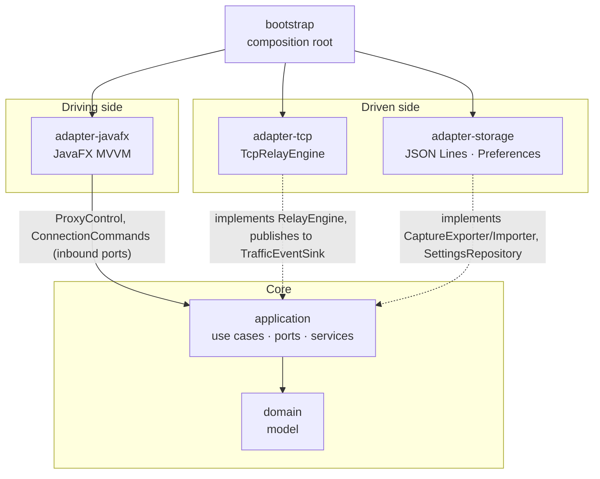
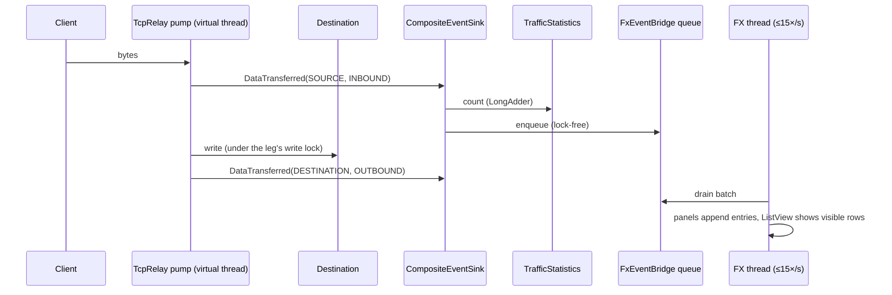

# WireLens architecture

This document explains how WireLens is organised, how data flows from a socket to the screen, how threads
cooperate, and how to extend the application.

## 1. Layers and the dependency rule

WireLens is a **hexagonal** application (also called *ports and adapters*). The core does not know which
networking library, file format or UI toolkit is used. It defines **ports** (interfaces), and
**adapters** implement them.

Each box is a **Gradle module**, so the compiler enforces the rule. `domain` has no dependencies, so it
physically cannot import a socket or a JavaFX class. `application` sees only `domain` and the
base-conversion library. Adapters never see each other. Only `bootstrap` knows every module.

## 2. The domain model

| Type | Kind | Notes |
|---|---|---|
| `IpAddress` | Value object | Strict IPv4 / IPv6 literal parser (no DNS). It rejects ambiguous input such as `010.0.0.1` and zone ids, writes RFC 5952 canonical text, and gives user-facing error messages. |
| `Port`, `Endpoint` | Value objects | `Endpoint` prints `[v6]:port` and parses its own output. |
| `Payload` | Value object | Immutable bytes. Copied in and never handed out, so it is safe to share between threads and between the two legs. |
| `ConnectionId`, `Link`, `Side`, `Direction` | Value objects | A `Link` is one leg (`SOURCE` = client ↔ proxy, `DESTINATION` = proxy ↔ server) with both socket ends. |
| `TrafficEvent` | Sealed interface | `ConnectionOpened`, `DataTransferred`, `StreamEnded`, `ConnectionClosed`, `ConnectionFailed`, `Notice`. Because the hierarchy is sealed, every `switch` is exhaustive, and the compiler flags any consumer that forgets a new event type. |
| `ProxyConfiguration` | Value object | Listen and destination endpoints, buffer size and connect timeout. |

**Raw bytes are the single source of truth.** No event stores decoded text. Every representation (text,
numbers, hex dump, raw hex) is a pure function of `Payload` plus the view's `RenderSettings`.

## 3. Ports

| Port | Direction | Implemented by |
|---|---|---|
| `ProxyControl` (start, stop, change destination, status) | inbound | `ProxyService` |
| `ConnectionCommands` (send typed bytes, disconnect) | inbound | `ProxyService` |
| `HoldCommands` (hold on/off, forward, edit, drop, send copy) | inbound | `HoldService` |
| `RelayEngine` / `RunningRelay` | outbound | `TcpRelayEngine` / `TcpRelay` |
| `TrafficGate` (asked before each chunk is forwarded) | outbound, implemented by the core | `HoldService` (or `TrafficGate.OPEN`) |
| `OneShotSender` (send a copy, collect the reply) | outbound | `TcpOneShotSender` |
| `TrafficEventSink` | outbound (Observer) | `TrafficStatistics`, `FxEventBridge`, composed by `CompositeEventSink` |
| `CaptureExporter` / `CaptureImporter` | outbound | `JsonLinesCapture`, `TextReportExporter` |
| `PayloadFileWriter` | outbound | `RawPayloadWriter` |
| `SettingsRepository` | outbound | `PreferencesSettingsRepository` (or an in-memory one in demo mode) |

## 4. From socket to screen

* The relay publishes **before** forwarding on the receiving leg and **after** a successful write on the
  sending leg. A failed write therefore shows up as received on one side plus an error on the other,
  which is exactly what happened.
* An end of stream is forwarded as a TCP **half-close** (`shutdownOutput`). A connection ends only when
  both directions have finished, so request/response protocols that close their sending side early still
  receive their answer.
* The first cause wins as the close reason: a peer closing, an error, the user disconnecting, or the
  proxy stopping. Once teardown starts, the socket errors it triggers are expected and are not reported.

### Hold mode

Holding is an application concern, so the TCP adapter only knows one question: *may I forward this?*
After a pump reads a chunk and publishes it as received, it calls `TrafficGate.admit(link, payload)`.

* With Hold off, `HoldService` answers `Forward` at once (one lock, no allocation beyond the decision).
* With Hold on for that side, it records a `HeldMessage`, notifies the UI, and blocks the pump's
  **virtual** thread on a `CompletableFuture<HoldDecision>`. Blocking a virtual thread is cheap, and it
  gives exactly the right semantics: later bytes of the same connection and direction queue up behind
  the held one in the socket (TCP back-pressure), while every other connection and the opposite
  direction keep flowing.
* The user's decision completes the future: `Forward(payload, edited)` or `Drop`. Edited bytes are
  written with `DataOrigin.EDITED`, so captures and exports show what was changed.
* When a connection ends, the relay calls `TrafficGate.release(id)`, which completes anything still held
  for it with `Drop`, so no thread is ever left waiting on a dead connection. Turning Hold off forwards
  whatever is waiting.

## 5. Threading model

| Thread | Work |
|---|---|
| Virtual thread: accept loop | `ServerSocket.accept()`, then hands the client to a `RelayedConnection`. |
| 2 virtual threads per connection | One pump in each direction, using plain blocking streams. |
| Any thread → `TrafficEventSink` | Must not block. Statistics use `LongAdder`; the bridge appends to a `ConcurrentLinkedQueue`. |
| FX application thread | `AnimationTimer` drains the bridge at most 15×/s, and a `Timeline` samples statistics every 500 ms. |
| `wirelens-ui-tasks` (1 platform thread) | Blocking work requested by the UI: start/stop, export, import, send, saving settings. |

Writes to one socket can come from the relay pump and from the user's send box at the same time. Each
`Leg` serialises them with a `ReentrantLock` rather than `synchronized`, which avoids pinning virtual
threads to their carrier while they block on I/O (Java 21).

`ProxyService` changes its state machine under its monitor and notifies listeners only after releasing
it. The UI's listener re-posts to the FX thread with `Platform.runLater`.

## 6. Keeping memory and the UI under control

A relay can move hundreds of megabytes per second, far more than a person can read. Three limits keep
WireLens stable:

1. **Bridge queue**: at most 200,000 events *and* 48 MiB of payload waiting for the UI. Beyond that,
   data events are counted and dropped *for display only*, and a notice tells the user. Statistics are
   fed directly and stay exact.
2. **Panel history**: each panel keeps at most N entries (50,000 by default) *and* 96 MiB of payload,
   dropping the oldest first. The two legs share the same `Payload` instance for relayed bytes, so the
   memory is not doubled.
3. **Rendering**: the `ListView` is virtualized and only visible cells render. Previews are capped at
   48 bytes for numbers and 160 for text, while the inspector shows everything. Each `TrafficEntry`
   caches its last preview, so scrolling never re-renders a row. Per-byte digits come from 256-entry
   lookup tables built once.

Measured result (45 s, `--stress`, 4 cores, software rendering): about 350 MB/s relayed, about 85,000
data events per second, a flat heap, and worst frame gaps similar to an idle window.

## 7. The UI: MVVM

* **View models** (`MainViewModel`, `TrafficPanelViewModel`, `EndpointInput`) hold all state as JavaFX
  properties and bindings and contain the UI logic: validation, limits, pause, filter, send-box parsing,
  and start/stop rules. They receive their executors (`background`, `ui`) as constructor arguments, so
  tests run them synchronously without a toolkit.
* **Views** (`HeaderView`, `TrafficPanelView`, `EntryCell`, `InspectorView`) only build controls and
  bind to properties.
* Validation reuses the domain: `EndpointInput` binds its error message to `IpAddress.validate(...)`, so
  the UI and the core can never disagree about what a valid address is.

## 8. Design patterns used

| Pattern | Where |
|---|---|
| Hexagonal / ports and adapters | Module layout, `port.in` / `port.out` |
| Value object | `IpAddress`, `Endpoint`, `Payload`, `RenderSettings`, `StatisticsSnapshot`, … |
| Observer | `TrafficEventSink`, status listeners, JavaFX properties |
| Composite | `CompositeEventSink` (fan-out with isolation of failing subscribers) |
| Facade / application service | `ProxyService`, `HoldService` |
| Gate / interceptor (with futures as the rendezvous) | `TrafficGate`, `HoldService`, `HoldDecision` (sealed) |
| State machine | `ProxyState` transitions in `ProxyService` |
| Strategy | `TextEncoding` (decoding), `Radix`, exporters behind `CaptureExporter` |
| Specification | `TrafficFilter` (a `Predicate<TrafficEvent>`) |
| Flyweight | `ByteDigits` lookup tables shared by every render |
| Producer/consumer with batching | `FxEventBridge` |
| MVVM | `adapter-javafx` |
| Composition root / manual DI | `bootstrap.WireLens` |

## 9. Use of the base-conversion library

`application` depends on `com.github.Mr-Alireza82:Base-Conversion` (JitPack):

* `BaseConversion.toDigits` builds the per-byte digit tables for every radix, padded to a fixed width:
  8 digits for binary, 3 for octal and decimal, 2 for hex.
* `ByteEncoding.toHex` produces the canonical raw-hex copy format and the JSON Lines payload field.
  `ByteEncoding.fromHex` reads it back.
* `ByteEncoding.fromHex` / `fromBits` and `BaseConversion.toNumber` parse what the user types in the send
  box.

The library's `Base` type stays inside `application`, behind WireLens' own `Radix` enum, so the UI never
depends on it directly.

## 10. Extending WireLens

| Goal | What to add |
|---|---|
| A new character encoding | A constant in `TextEncoding`. It appears in the menus automatically. |
| A new export format | A class implementing `CaptureExporter` in `adapter-storage`, registered in `bootstrap.WireLens`. |
| UDP, SOCKS5 or TLS relaying | A new adapter implementing `RelayEngine` that publishes the same `TrafficEvent`s. The UI needs no change. |
| Protocol decoding (e.g. ISO 8583 fields) | A new rendering strategy in `application.render` plus an inspector tab. |
| A different UI (CLI, web) | A new driving adapter that uses `ProxyControl` and subscribes to `CompositeEventSink`. |
