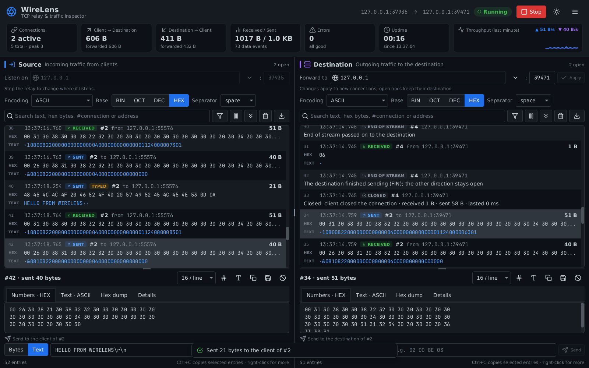

# Building WireLens: a TCP traffic inspector in modern Java

*How hexagonal architecture, sealed types, virtual threads and one strict rule ("raw bytes are the source
of truth") produced a fast, readable proxy with a polished JavaFX interface.*

---

## The problem

When a payment terminal and a host disagree, the evidence is in the bytes. A length header can be off by
one. A field can be encoded in EBCDIC instead of ASCII. A host can close the socket a moment too early.
To see the bytes you usually chain together a port forwarder, a sniffer and a hex editor, and then copy
data between them, which loses context each time.

**WireLens** puts all three in one window. It listens on an address you choose, forwards every client to
a destination, and records each connection in two panels: the **source** side (client ↔ proxy) and the
**destination** side (proxy ↔ server). Every event is a separate entry that can be inspected, searched
and copied. You can view the bytes as text in five encodings, or as numbers in base 2, 8, 10 or 16, with
any separator you like.



## One rule above all: raw bytes are the source of truth

The first design question was what to store. A tempting answer is "the decoded text plus the bytes". But
decoding is a pure function: the same bytes and charset always give the same text. Storing the text
doubles memory use and adds nothing. Worse, it invites drift: which copy wins if they ever disagree?

So WireLens stores **only the bytes**, in an immutable `Payload`, and derives everything else when it is
displayed:

```java
public String numbers(Payload payload, RenderSettings settings, int maxBytes) { ... }
public String text(Payload payload, TextEncoding encoding, int maxBytes) { ... }
public String hexDump(Payload payload, TextEncoding encoding) { ... }
public String rawHex(Payload payload) { return ByteEncoding.toHex(payload.toByteArray()); }
```

To keep the *original presentation* reproducible, each row remembers the view settings that were active
when it arrived (`capturedWith`). That is a reference to a small immutable record, not a second copy of
the data.

This rule decided the selector behaviour too. Because every view is derived, changing the base or
encoding **re-renders all entries**, old and new. That costs almost nothing because the list is
virtualized and only visible rows are drawn. The alternative, where only new data uses the new setting,
would leave one list in mixed formats, which is confusing. Each panel has **its own** selectors, because
the two sides of a conversation often need different views, such as readable requests next to binary
responses.

## Architecture: a hexagon in Gradle modules

I come from Android and payment systems, where code lives for a decade and the frameworks around it keep
changing. Hexagonal architecture (ports and adapters) handles that well: the core states what it needs as
interfaces, and the edges plug in.

```
domain           value objects + the sealed TrafficEvent hierarchy (no dependencies)
application      use cases, ports, ProxyService, statistics, rendering, filtering
adapter-tcp      RelayEngine implementation: sockets and virtual threads
adapter-storage  capture files and preferences
adapter-javafx   the MVVM user interface
bootstrap        main(): the only place that knows every module
```

Making each layer a **Gradle module** turns the dependency rule from a convention into a compiler error.
`domain` cannot import `java.net.Socket` or JavaFX, because those are not on its classpath. When I later
want SOCKS5, UDP or TLS, I can add another `RelayEngine` adapter, and the UI will not notice.

### The domain speaks in events

Everything the relay does is a `TrafficEvent`, and the hierarchy is **sealed**:

```java
public sealed interface TrafficEvent {
    record ConnectionOpened(Instant timestamp, Link link) implements OnLink { ... }
    record DataTransferred(Instant timestamp, Link link, Direction direction,
                           Payload payload, DataOrigin origin) implements OnLink { ... }
    record StreamEnded(...)      implements OnLink { ... }
    record ConnectionClosed(...) implements OnLink { ... }
    record ConnectionFailed(...) implements TrafficEvent { ... }
    record Notice(...)           implements TrafficEvent { ... }
}
```

Consumers use exhaustive `switch` with pattern matching: the statistics, the filter, the exporter, the
list cell and the inspector. If I add an event type tomorrow, every place that must handle it fails to
compile until it does. That is the compiler acting as a checklist.

Value objects guard the edges. `IpAddress.parse` is a strict, DNS-free parser for IPv4 and IPv6 that
rejects ambiguous input (is `010.0.0.1` octal?) and explains each problem in plain language. The UI binds
its error messages directly to `IpAddress.validate(text)`, so the screen and the core use the same rules.

## Networking: boring code, thanks to virtual threads

A relay is two copy loops per connection. Before Java 21 you had to choose between simple
thread-per-connection code, which used too many OS threads, and scalable NIO selectors, which were hard
to read. **Virtual threads** remove that trade-off:

```java
private void pump(Leg from, Leg to) {
    byte[] buffer = new byte[configuration.bufferSize()];
    while (true) {
        int count = from.read(buffer);              // blocks a virtual thread, not an OS thread
        if (count < 0) { passHalfCloseOn(from, to); return; }
        Payload payload = Payload.copyOf(buffer, 0, count);
        sink.publish(new DataTransferred(now(), from.link(), INBOUND, payload, RELAYED));
        to.write(payload, RELAYED, sink, clock);    // publishes OUTBOUND after a successful write
    }
}
```

Several details matter in practice:

* **Half-close is forwarded.** When the client sends FIN, the proxy calls `shutdownOutput()` on the
  server socket and keeps reading the response. Many protocols rely on this, and naive proxies break them.
* **Writes are serialised with a `ReentrantLock`.** Relayed bytes and bytes the user types in the send box
  can hit the same socket at the same time. `synchronized` would pin the virtual thread to its carrier
  during blocking I/O, so a `ReentrantLock` is used instead.
* **The first cause wins.** Peer close, error, user disconnect or proxy stop sets the close reason, and the
  socket errors caused by tearing down on purpose are not reported as failures.
* **The same `Payload` object is published on both legs.** Relayed bytes therefore cost memory only once.

The integration tests use real sockets on loopback. They cover a request/response with half-close, an
8 MB byte-exact transfer (SHA-256), 100 concurrent clients, typed bytes sent in either direction,
disconnect, stop, re-targeting, IPv6 and a busy port.

## Keeping a JavaFX UI smooth under a firehose

A relay can produce tens of thousands of events per second. Calling `Platform.runLater` once per event
would flood the UI thread. WireLens puts a **batching bridge** in between:

1. Network threads append to a lock-free queue and return immediately.
2. An `AnimationTimer` on the FX thread drains the queue at most 15 times per second and hands each panel
   one batch.
3. The queue is bounded by event count *and* by bytes. Under overload, data events are counted and
   dropped *for display only*, and a notice says so. Statistics are fed separately and stay exact.

Each panel also limits its history by entry count and by bytes, so memory stays flat however long you
capture. The first stress run did hit an `OutOfMemoryError`, because a count-only limit with 16 KB chunks
still adds up to gigabytes. That run is why both limits now count bytes.

Rendering is cheap by construction. Per-byte digits come from 256-entry lookup tables (a flyweight) built
once with the `base-conversion` library. List cells show capped previews and cache them, and the
inspector renders the full payload only for the selected entry.

In the stress mode (`--stress`), four clients send as fast as possible. WireLens relayed about 350 MB/s
for 45 seconds on a 4-core container with a software renderer, with a flat heap and UI frame gaps no
worse than an idle window.

## The UI: MVVM with a designer's eye

The interface has three regions. A **header** shows status, route and live tiles: connections, bytes
each way, totals, errors, uptime, and a one-minute throughput sparkline. Two **resizable panels** sit
side by side, each with its own vertical splitter between the entry list and the inspector. A few
choices that matter:

* **The header height follows its content.** The brief suggested 15 to 25% of the window. A fixed
  percentage wastes space on tall screens and clips tiles on short ones, so the header sizes to its
  content and comes out at about 15% of a typical window.
* **Representations are labelled.** Every data row shows a `HEX`/`BIN`/… line and a `TEXT` line. The
  inspector adds a hex dump, the canonical raw hex and the full metadata. You never wonder what you are
  looking at.
* **Direction and origin are badges.** `RECEIVED` and `SENT` are colour-coded consistently, and bytes
  you injected are marked `TYPED`.
* **Invalid input cannot be submitted.** Endpoint fields and the send box validate on every keystroke
  with specific messages.

The view models contain all the logic and receive their executors through the constructor. Tests run
them synchronously without starting JavaFX, which keeps the UI layer as testable as the core.

## Reusing a library the right way

The per-byte formatting and the send-box parser use my own
[base-conversion](https://github.com/Mr-Alireza82/base-conversion) library, consumed through JitPack
rather than copied in. Its types stay inside the application layer behind WireLens' own `Radix` enum, so
the dependency is an implementation detail that can be swapped out later. For offline work, the build
can substitute a local checkout with one Gradle property, using a composite build.

## Results and next steps

* 6 modules and about 6,400 lines of production Java.
* 144 automated tests, including real-socket integration tests.
* A lossless capture format (JSON Lines) that you can export and reopen.
* A demo mode with a simulated ISO 8583-style host, so the app is useful within seconds of cloning.

Next on the roadmap are protocol decoders as plugins (starting with an ISO 8583 field breakdown), TLS
termination, SOCKS5/HTTP CONNECT front ends, PCAP export and native installers. Thanks to the ports, each
of these is an addition rather than a rewrite.

*Source code, build instructions and more screenshots: see the [README](../README.md).*
